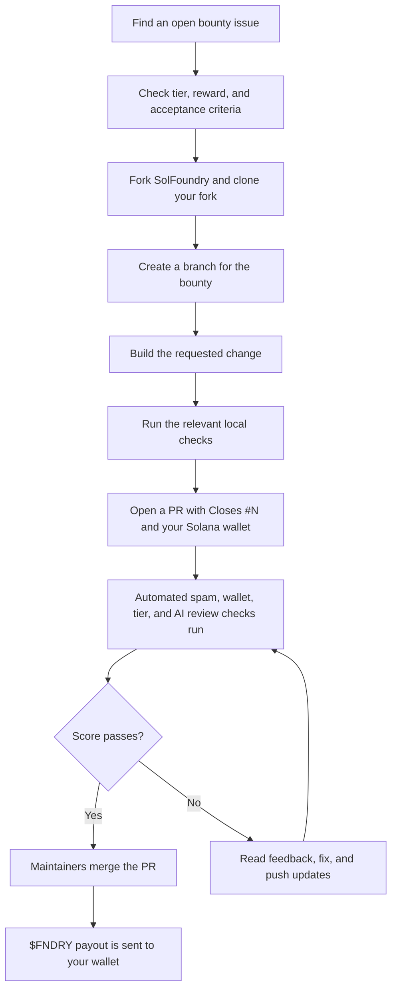
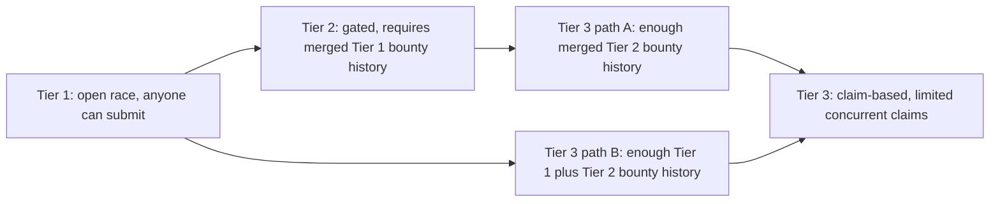

# Getting Started with SolFoundry

SolFoundry is an open-source bounty platform where contributors ship work through GitHub pull requests and earn `$FNDRY` rewards on Solana after review and merge. This tutorial walks through the full first-time contributor flow: finding a bounty, preparing your fork, opening a compliant PR, passing AI review, and receiving rewards.

Use this as a beginner-friendly README or blog post before starting your first bounty.

## Contributor Flow



## Before You Start

You need:

- A GitHub account.
- Git installed locally.
- A Solana wallet address for payouts. Phantom is recommended in the contributing guide.
- Node.js 18+ for frontend work.
- Python 3.10+ for backend work.
- Rust and Anchor only if the bounty touches smart contracts.
- Docker and Docker Compose if you want the fastest full-stack local setup.

Keep your Solana wallet address handy. Every bounty PR must include it in the PR description, otherwise the wallet check can warn or close the PR before payout.

## Step 1: Find a Bounty

Open the SolFoundry issues page and filter by the `bounty` label:

https://github.com/SolFoundry/solfoundry/issues?q=is%3Aissue+is%3Aopen+label%3Abounty

Read the issue carefully before writing code. A good bounty issue usually tells you:

- The reward amount.
- The tier, such as `tier-1`, `tier-2`, or `tier-3`.
- The domain, such as frontend, backend, contracts, tests, or docs.
- Requirements and acceptance criteria.
- Any special constraints, deadlines, or examples.

For your first bounty, start with Tier 1. Tier 1 bounties are open races: no claim is required, and the first clean PR that satisfies the issue and passes review can win.

## Step 2: Understand the Tier System

SolFoundry uses tiers to keep beginner work open while reserving harder work for proven contributors.



### Tier 1

- Anyone can submit.
- No claiming is needed.
- First quality PR that passes review wins.
- Best place to build your track record.

### Tier 2

- Gated by previous merged Tier 1 bounty work.
- Still works like an open race once you are eligible.
- The claim guard checks your contribution history automatically.

### Tier 3

- Gated by stronger previous bounty history.
- Claim-based: comment `claiming` on the issue before starting.
- Intended for larger or higher-risk work.
- Contributors can only hold a limited number of concurrent Tier 3 claims.

The exact eligibility and score thresholds can change as the project evolves, so treat `CONTRIBUTING.md`, the issue labels, and GitHub Actions output as the source of truth.

## Step 3: Fork and Clone the Repository

Fork the repository from GitHub, then clone your fork locally:

```bash
git clone https://github.com/<your-github-username>/solfoundry.git
cd solfoundry
git remote add upstream https://github.com/SolFoundry/solfoundry.git
git fetch upstream
```

Create a branch that names the bounty:

```bash
git switch -c feat/bounty-830-getting-started upstream/main
```

Use a prefix that matches the work:

- `feat/` for new features.
- `fix/` for bug fixes.
- `docs/` for documentation.
- `test/` for tests.
- `refactor/` for internal cleanup.

Examples:

```bash
feat/bounty-18-nav-shell
fix/bounty-502-wallet-validation
docs/bounty-830-getting-started
```

## Step 4: Set Up the Project Locally

For the full stack, use Docker:

```bash
cp .env.example .env
docker compose up --build
```

For frontend-only work:

```bash
cd frontend
npm install
npm run dev
```

For backend-only work:

```bash
cd backend
python -m venv .venv
source .venv/bin/activate
pip install -r requirements.txt
uvicorn app.main:app --reload --port 8000
```

On Windows PowerShell, activate the backend virtual environment with:

```powershell
.\.venv\Scripts\Activate.ps1
```

## Step 5: Build the Bounty

Work directly from the issue acceptance criteria. Keep the change focused and avoid unrelated refactors.

Before committing, run the checks that match the files you changed:

```bash
# Frontend
cd frontend
npm run build
npm test
```

```bash
# Backend
cd backend
ruff check .
pytest
```

```bash
# Contracts, when relevant
anchor test
```

If a full test suite has known unrelated failures, still run the most relevant targeted checks and explain exactly what you ran in the PR description.

## Step 6: Commit and Push Your Branch

Review your diff:

```bash
git status --short
git diff
```

Commit with a clear message:

```bash
git add <changed-files>
git commit -m "docs: add getting started tutorial"
git push -u origin docs/bounty-830-getting-started
```

If your local remote names are `origin` for upstream and `fork` for your fork, push to `fork` instead:

```bash
git push -u fork docs/bounty-830-getting-started
```

## Step 7: Open a Pull Request

Open the PR against `SolFoundry/solfoundry` `main`.

Your PR description must include:

- `Closes #N`, where `N` is the bounty issue number.
- Your Solana wallet address.
- A short summary of the change.
- The checks you ran.

Example:

```markdown
Closes #830

## Summary
- Add a beginner-friendly Getting Started tutorial for SolFoundry contributors.
- Cover bounty tiers, fork/branch flow, PR requirements, and AI review.
- Include Mermaid diagrams for the contributor flow and tier progression.

## Verification
- git diff --check

**Wallet:** <your-solana-wallet-address>
```

The `Closes #N` line links your PR to the bounty. Without it, the spam filter can close the PR automatically. Without a wallet address, you can pass code review but still fail payout requirements.

## Step 8: Pass Automated Review

After you open the PR, GitHub Actions run automatically:

- Spam checks reject missing bounty links, trivial diffs, binary files, `node_modules`, duplicate work, and placeholder-heavy submissions.
- Wallet checks verify that a Solana wallet address is present.
- Tier checks verify that you are eligible for gated bounties.
- The AI review pipeline scores the PR.

The AI review uses multiple models in parallel, aggregates scores with a trimmed mean, and posts feedback. A trimmed mean drops the highest and lowest model scores and averages the middle scores so one outlier does not dominate the result.

Review focuses on:

- Correctness: does the PR satisfy the issue?
- Completeness: are all acceptance criteria covered?
- Quality: is the implementation clean and maintainable?
- Security: does it avoid unsafe patterns?
- Tests: are the right checks included?
- Integration: does it fit the existing codebase?

If the score is below the threshold, read the feedback, fix the issue on the same branch, and push again:

```bash
git add <changed-files>
git commit -m "fix: address bounty review feedback"
git push
```

The review runs again on the updated PR.

## Step 9: Merge and Earn Rewards

Once the PR passes review and maintainers merge it, the bounty can be paid in `$FNDRY` to the wallet address in your PR.

Rewards only count toward tier progression when the linked issue has both:

- A `bounty` label.
- A tier label such as `tier-1`, `tier-2`, or `tier-3`.

Star rewards, content-only promotions, non-bounty PRs, and unrelated fixes do not count toward tier progression.

## Pre-PR Checklist

Before opening a bounty PR, confirm:

- The issue is still open.
- The issue has a `bounty` label and a tier label.
- You understand every acceptance criterion.
- Your branch name references the bounty.
- Your PR description includes `Closes #N`.
- Your PR description includes your Solana wallet address.
- You ran the relevant local checks.
- You did not commit `.env`, secrets, binaries, `node_modules`, or generated junk.
- Your change is focused on the bounty and does not include unrelated cleanup.

## Common Mistakes

### Missing `Closes #N`

Add the exact bounty issue reference to the PR body:

```markdown
Closes #830
```

### Missing wallet address

Add your Solana wallet address to the PR body. No wallet means no payout.

### Working on a gated bounty too early

If you do not have enough merged bounty history, start with Tier 1. Tier 2 and Tier 3 checks are automated.

### Ignoring acceptance criteria

Do not ship a partial version of the issue. The AI review checks the PR against the bounty text.

### Opening multiple PRs for the same bounty

Keep updates on the same PR branch. If you need a new approach, close the old PR first.

## Quick Reference

```bash
# 1. Sync with upstream
git fetch upstream

# 2. Create a bounty branch
git switch -c docs/bounty-830-getting-started upstream/main

# 3. Make the change, then inspect it
git status --short
git diff

# 4. Run relevant checks
git diff --check

# 5. Commit and push
git add docs/GETTING_STARTED_TUTORIAL.md README.md
git commit -m "docs: add getting started tutorial"
git push -u fork docs/bounty-830-getting-started
```

Then open a PR with `Closes #830`, your Solana wallet address, a summary, and verification notes.
